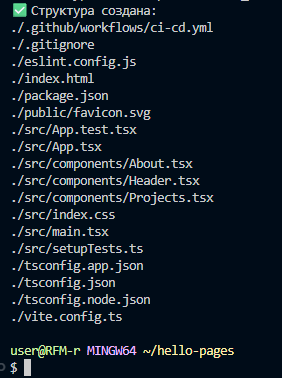
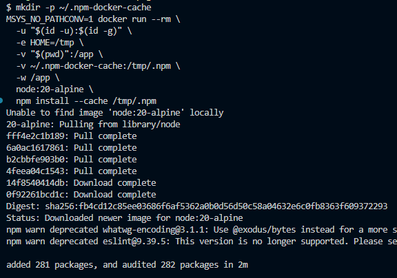
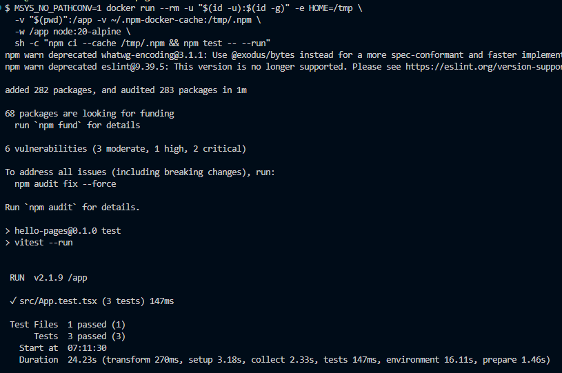
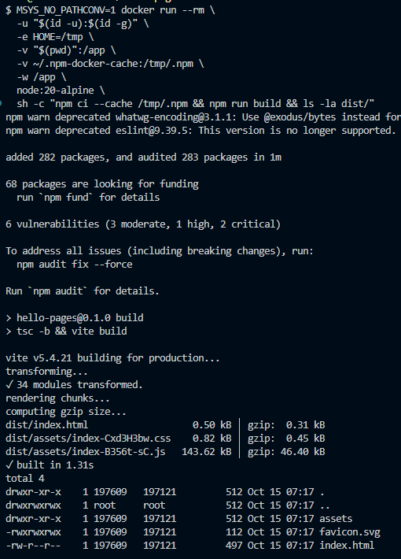
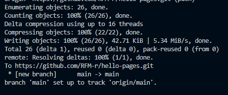
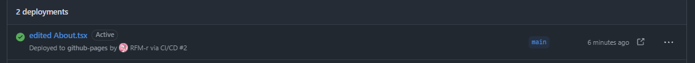
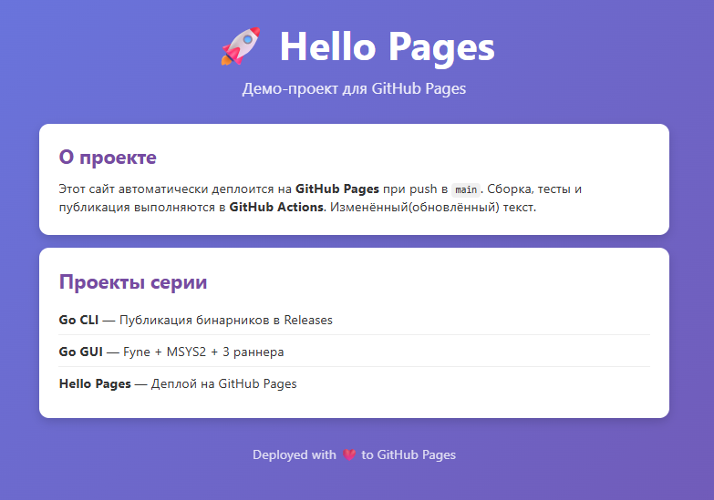

# Самостоятельная работа по DevOps/Pipelines: CI/CD на GitHub Pages

## 1. Создание структуры в корневой домашней папке:

## 2. Генерация package-lock.json:

## 3. Тесты в Docker:

## 4. Локальная сборка под GitHub Pages:

## 5. Commit и Push проекта в новый репозиторий:

### Ссылка на новый репозиторий: https://github.com/RFM-r/hello-pages

## 6. Commit in Github Actions:

## 7. Deployments Check:

## 8. Website(Edited):
