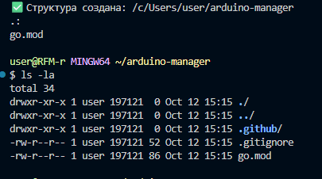
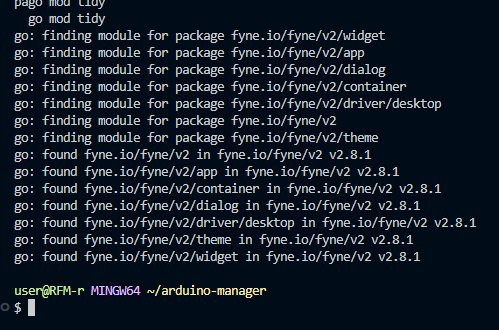
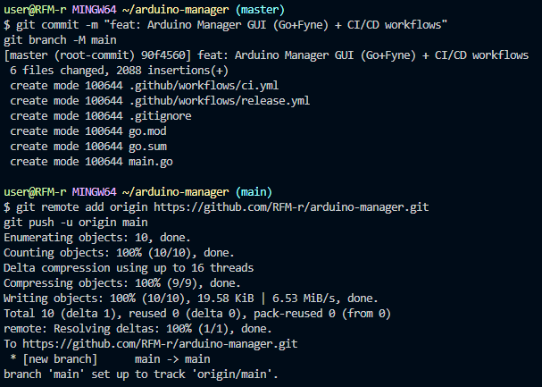
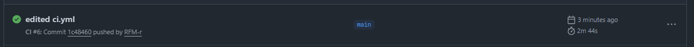
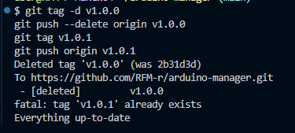
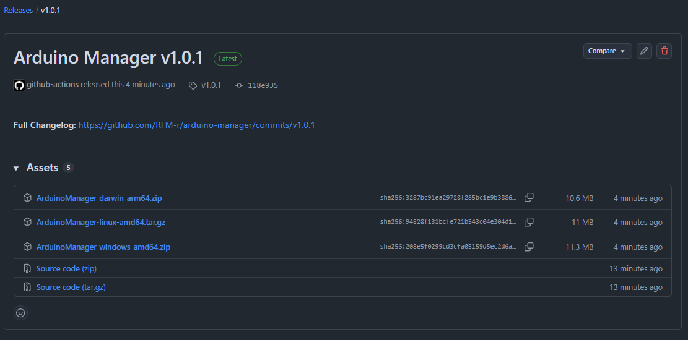
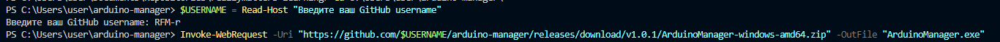
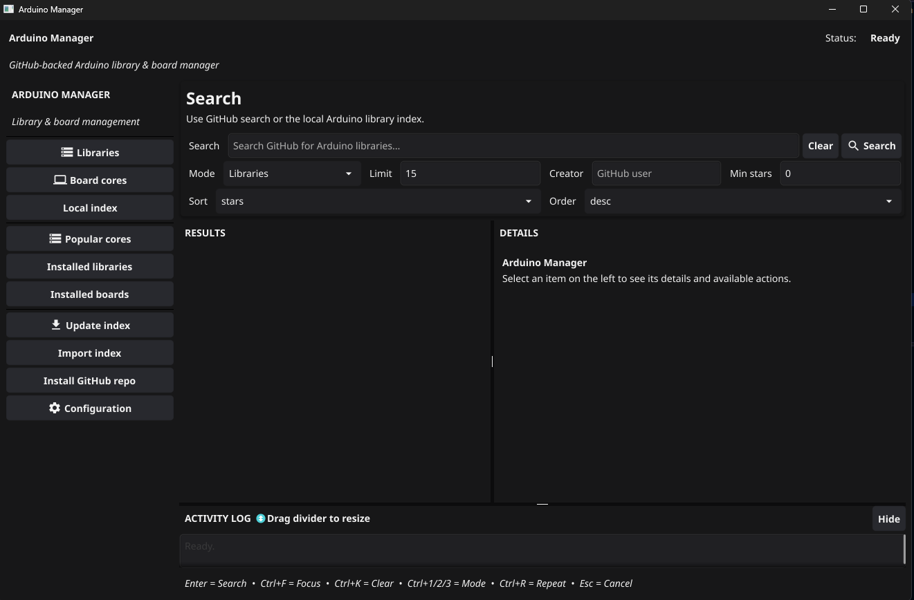

# Самостоятельная работа по DevOps/Pipelines: CI/CD с приложением на Go (Fyne) - Arduino Manager GUI + GH Releases

## 1. Структура:

## 2. Подготовка Go модуля и ресурсов:

## 3. Commit и Push проекта в новый репозиторий:

### Ссылка на новый репозиторий: https://github.com/RFM-r/arduino-manager

## 4. Commit in Github Actions:

## 5. Создание релиза(GitHub Releases):

## 6. Запуск и работа приложения:

