# Самостоятельная работа по Docker Databases: Aliases in MySQL:

## 1. Запуск контейнера:
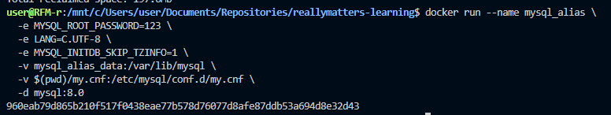

## 2. Подключение к MySQL:
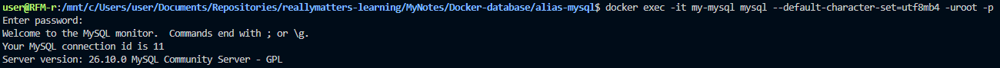

## 3. Создание БД и таблиц:
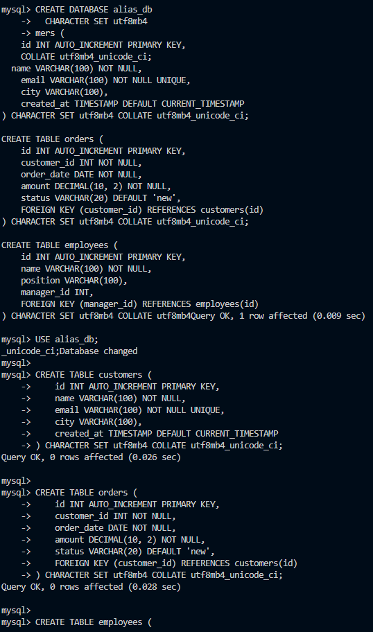

## 3.1. Заполнение их данными:
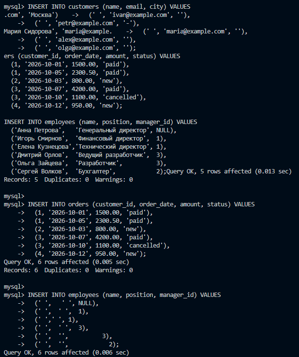

## 3.2. Проверка:
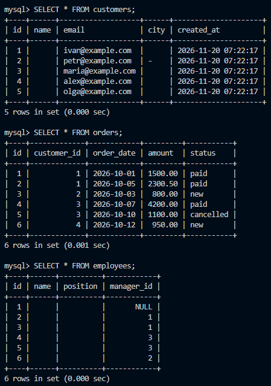

## 4. Алиасы таблиц:
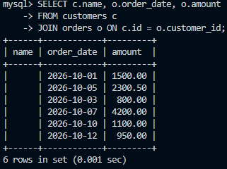

## Обязательное использование алиаса:
### 4.1. Самосоединение:
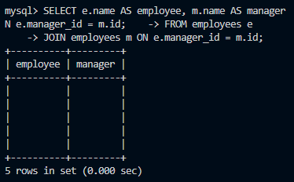
### 4.2. Неоднозначные имена столбцов:
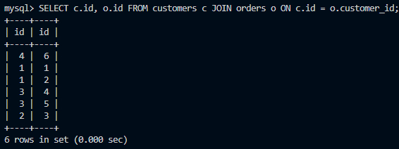
### 4.3. Производные таблицы:
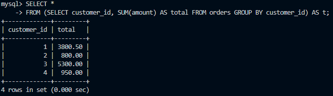

## 5. Алиасы столбцов:
### Example:
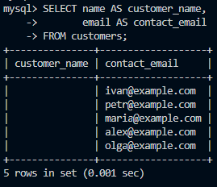
### 5.1. Алиас в `ORDER BY`:
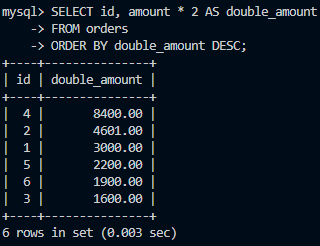
### 5.2. Алиас в `WHERE`:
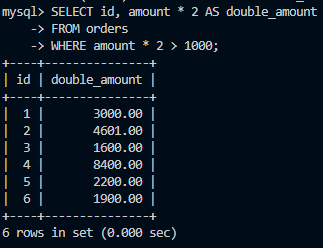

## 6. Алиасы в подзапросах:
### 6.1. `FROM`:
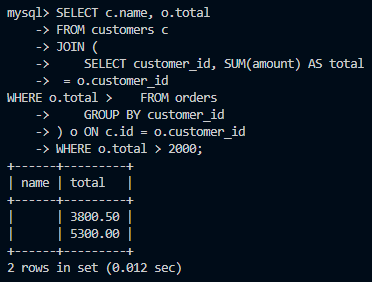
### 6.2. `SELECT`:
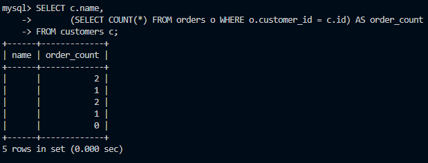

## 7. Алиасы и `JOIN`:
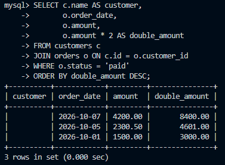

## 8. Полный пример "до и после":
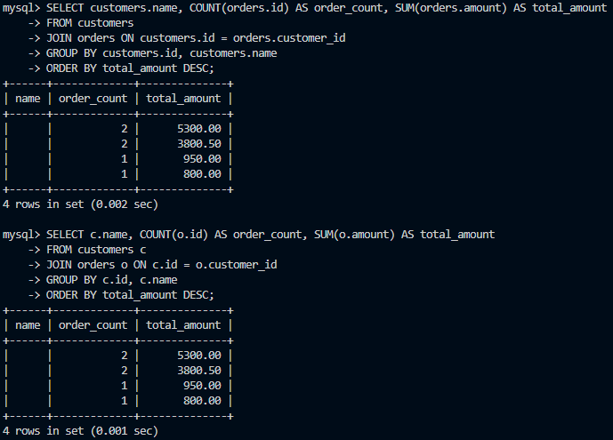

## 9. Создание лога:
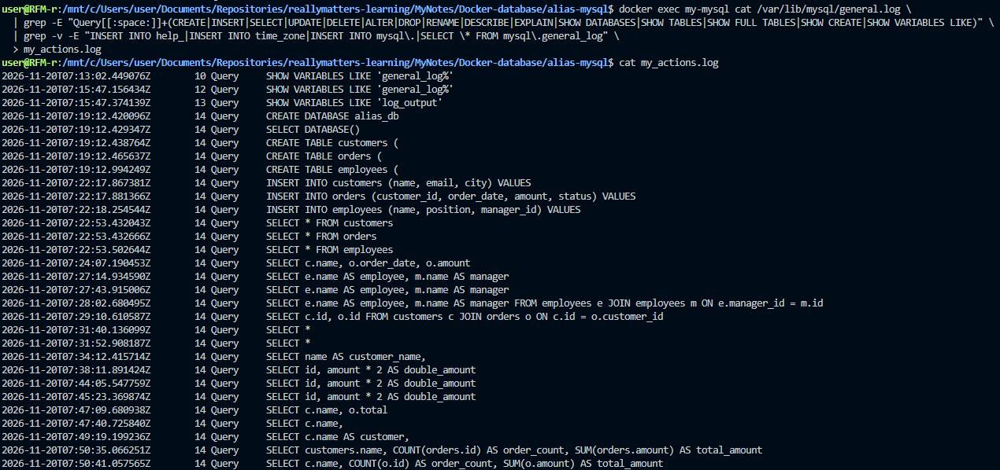

## 10. Создание дампа:
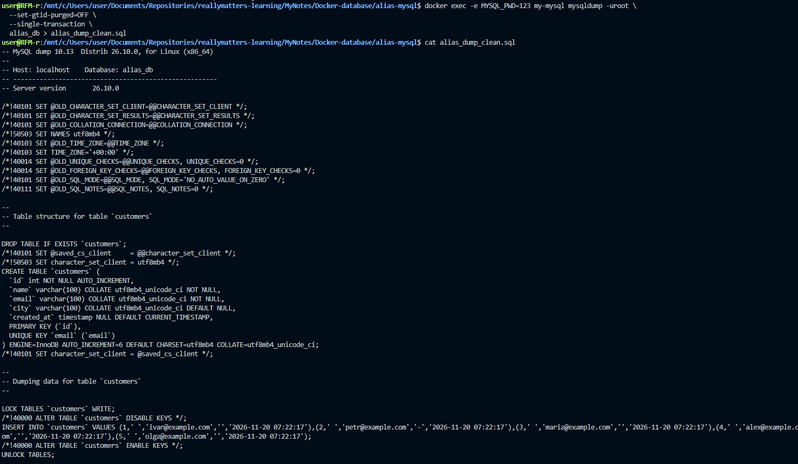