# Самостоятельная работа по Docker Databases: Index in MySQL

## 1. Запуск контейнера:
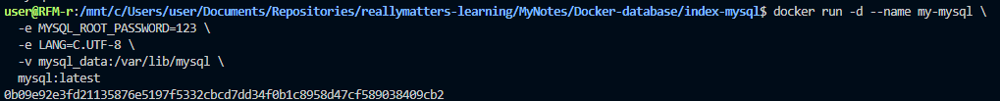

## 2. Подключение к MySQL:
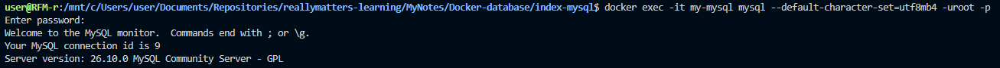

## 3. Создание БД и таблиц:
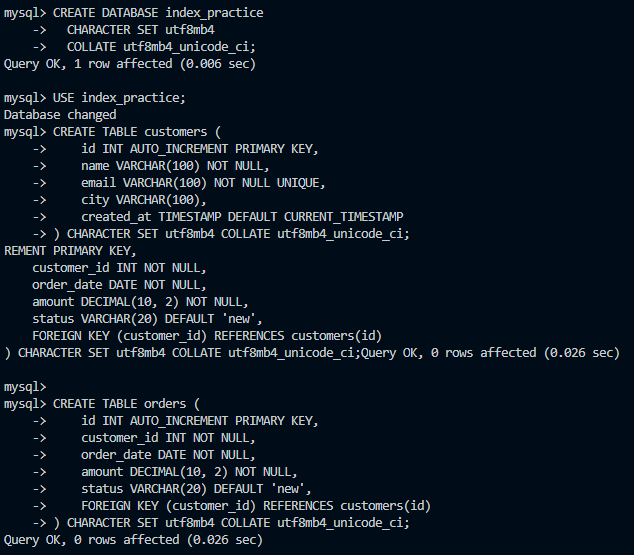
## 3.1. Заполнение их данными:
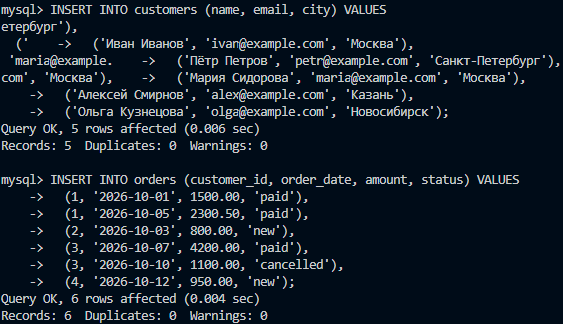
## 3.2. Проверка:
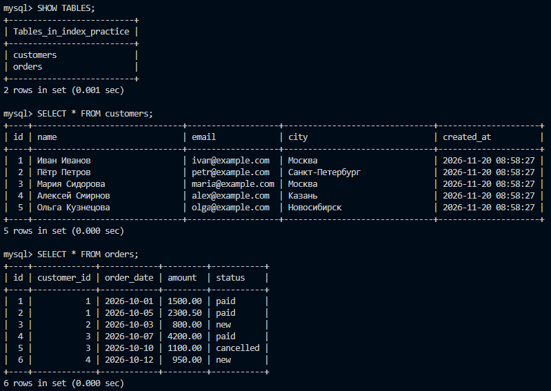

## 4. Эксперимент 1: какие индексы уже существуют:
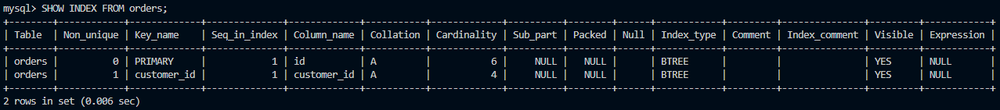
## 4.1. Эксперимент 2: `EXPLAIN` до индекса:
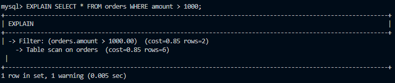
## 4.2. Эксперимент 3: `CREATE INDEX` и `EXPLAIN` после:
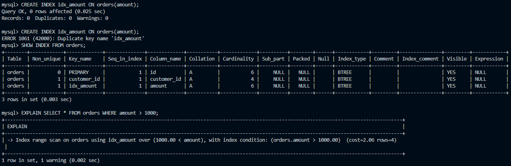
## 4.3. Эксперимент 4: функция в `WHERE` ломает индекс:
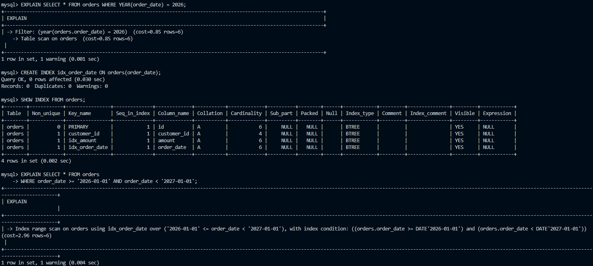
## 4.4. Эксперимент 5: составной индекс:
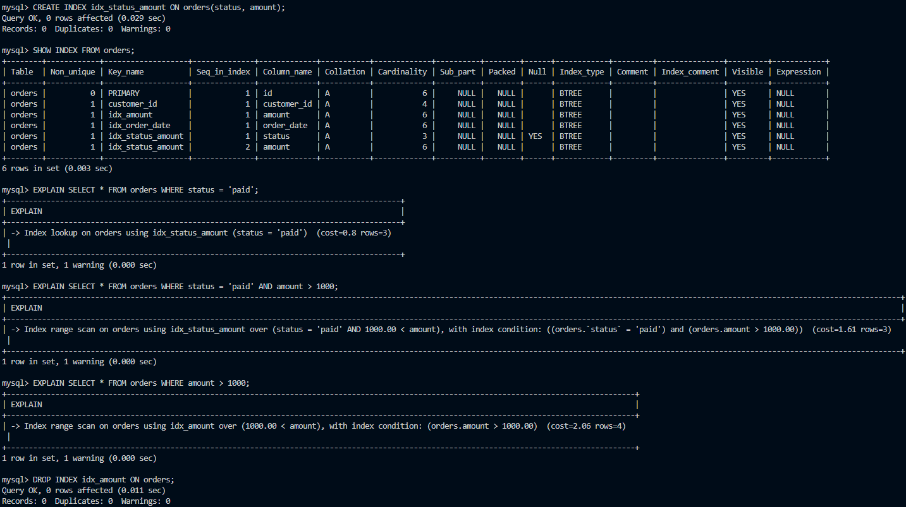
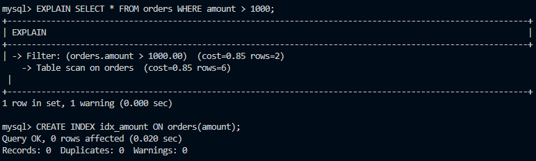
## 4.5. Эксперимент 6: покрывающий индекс:
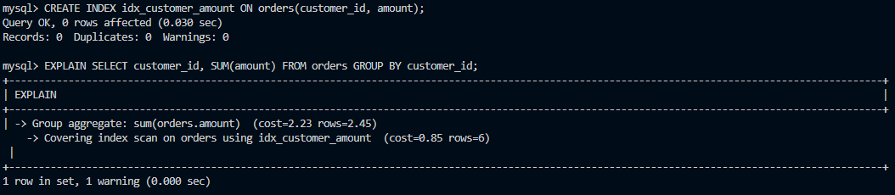

## 5. Создание лога:
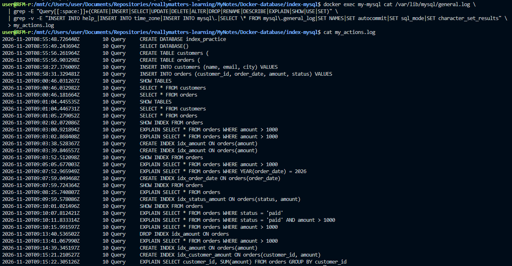

## 6. Создание дампа:
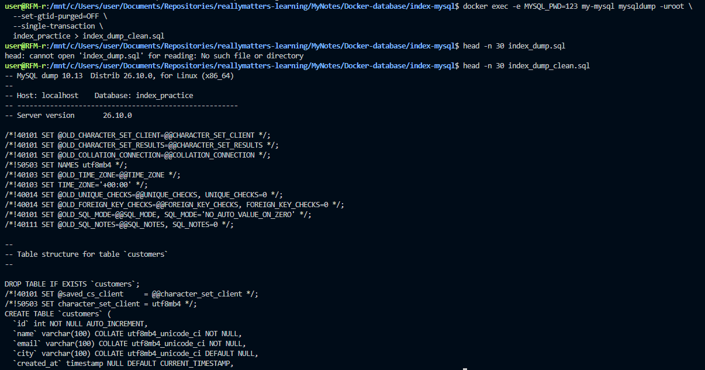