## Самостоятельная работа по Docker Databases: MySQL (#2)

## 1. Подключение к MySQL:
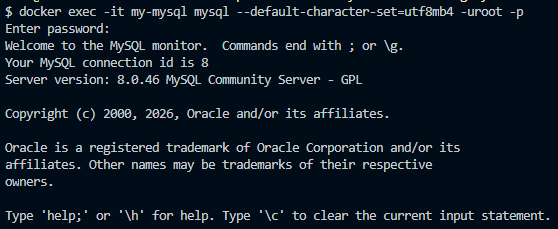

## 2. Создание учебной базы данных:
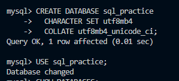

## 2.1. Создание и просмотр VIEW для фильтрации лога:
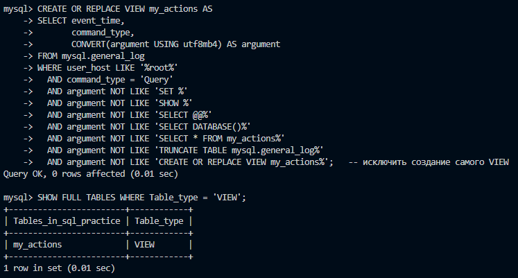

## 3. Создание таблиц и их просмотр:
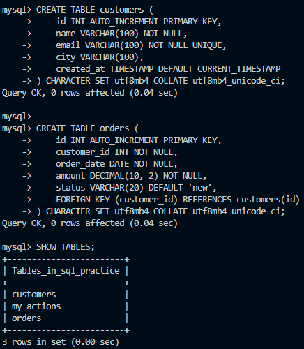

## 4. Вставка данных:
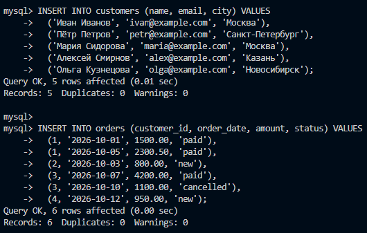

## 4.1. Проверка вставки:
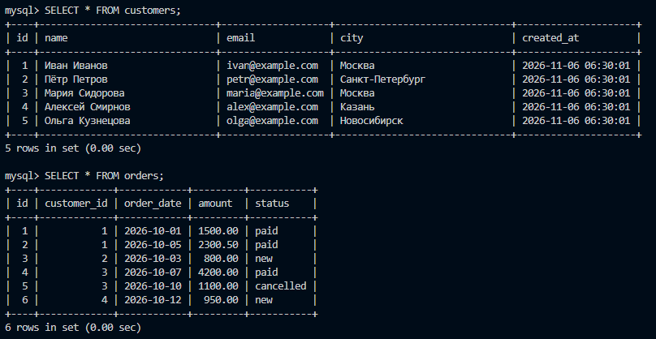

## 5. Выборка данных:
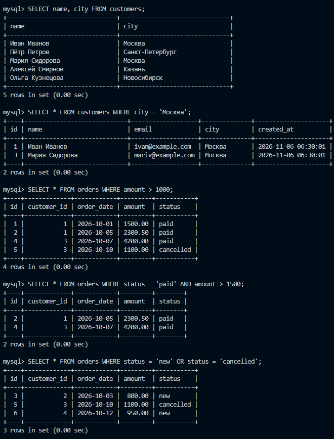
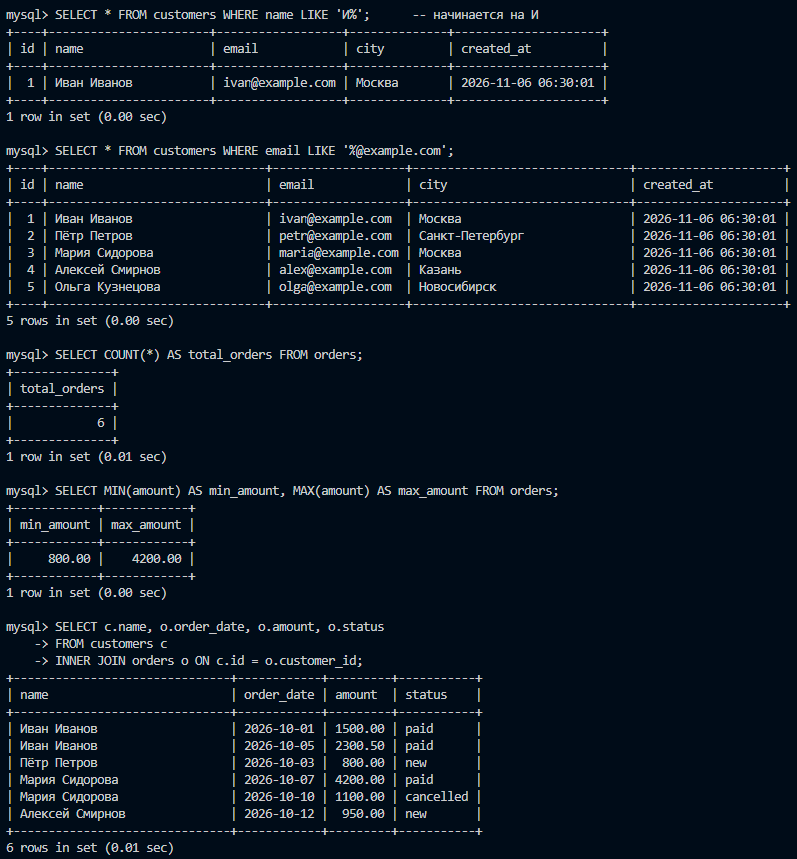

## 5.1. Подзапросы:
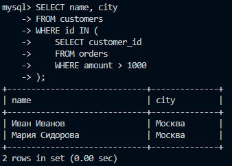

## 5.2. UNION:
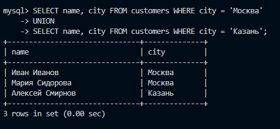

## 6. Обновление данных (UPDATE):
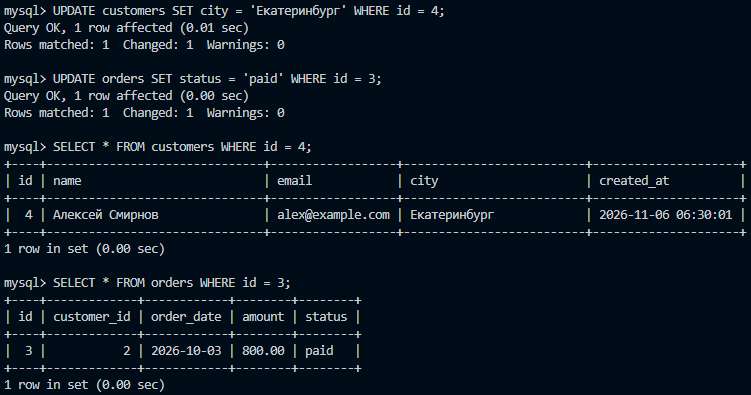

## 7. Удаление данных (DELETE):
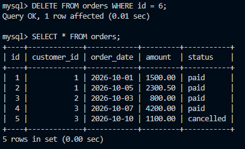

## 8. Изменение структуры (ALTER TABLE):
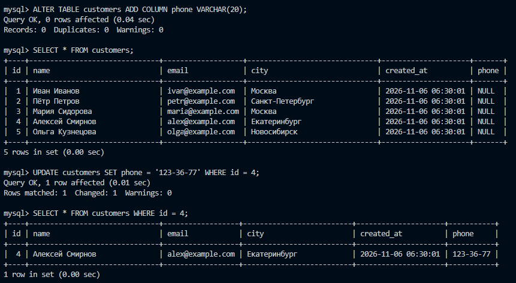

## 9. Просмотр лога:
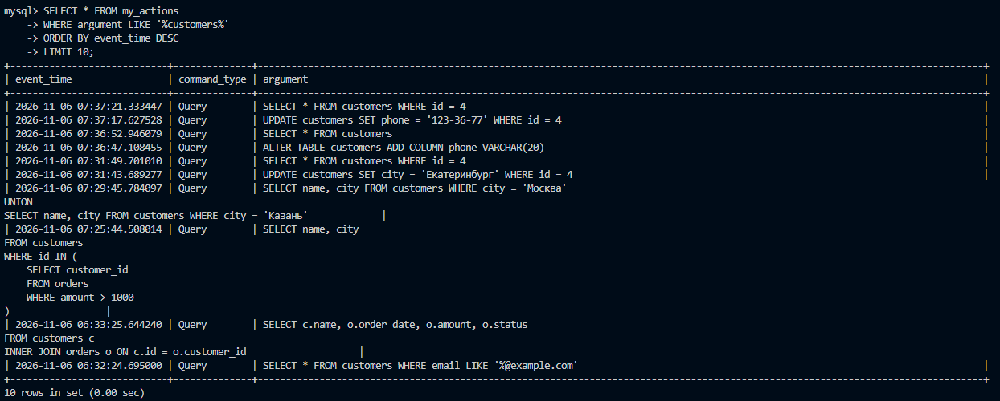

## 9.1. Экспорт лога в файл на хосте:
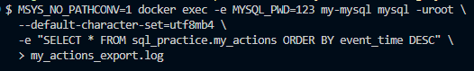

## 9.2. Просмотр содержимого логов:
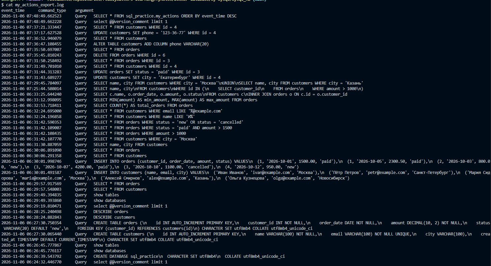

## 9.3. Создание дампа БД и его просмотр:
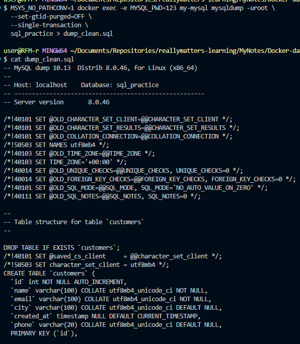

## 10. Удаление таблиц и базы:
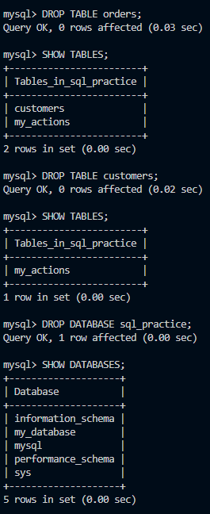

## 11. Восстановление удалённой БД:
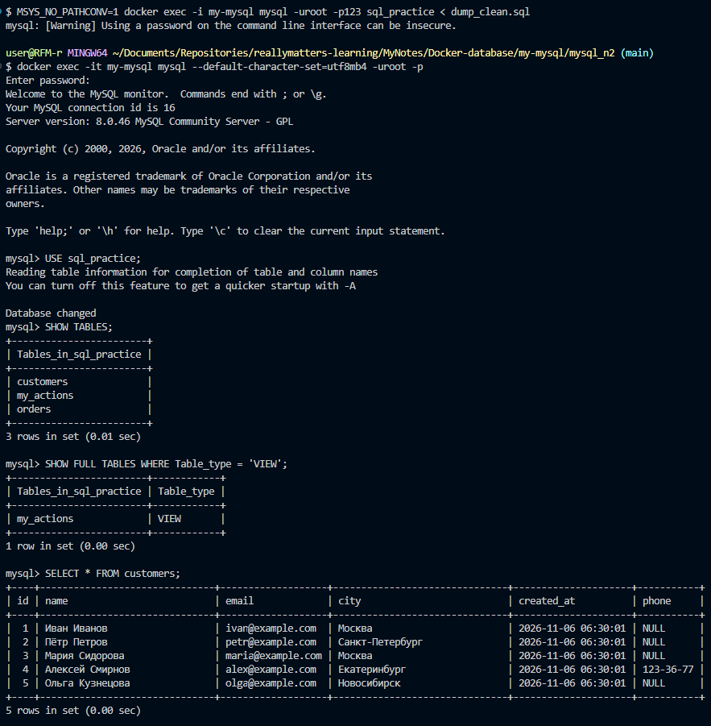