## Самостоятельная работа по Docker Databases: MySQL

## 1. Запуск контейнера:
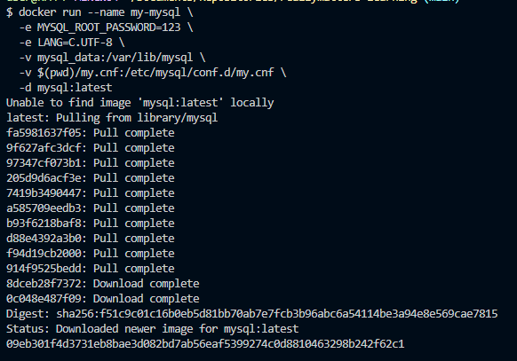

## 2. Подключение к MySQL:
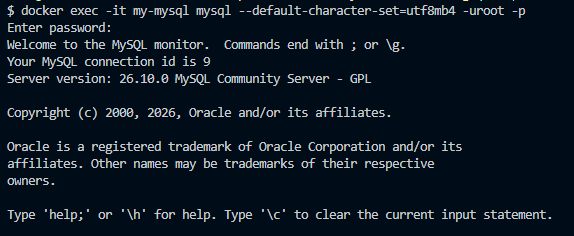

## 3. Просмотр существующих баз данных:
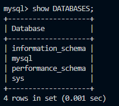

## 4. Создание базы данных:
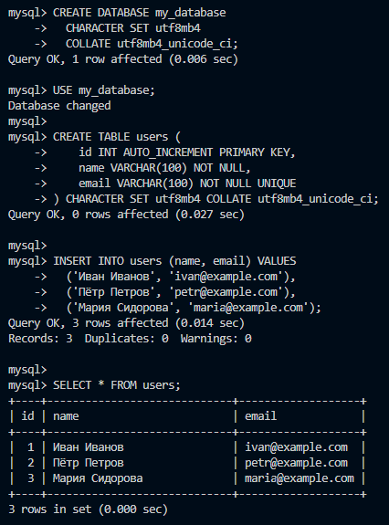

## 5. Добавление новых данных в таблицу:
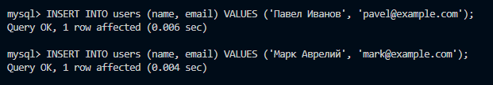

## 6. Обновление одной строки в таблице:
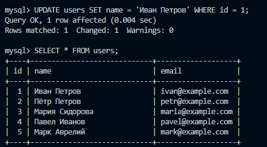

## 7.1. Создание новой базы данных и переход в неё:
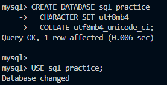

## 7.2. Создание таблиц в этой базе данных:
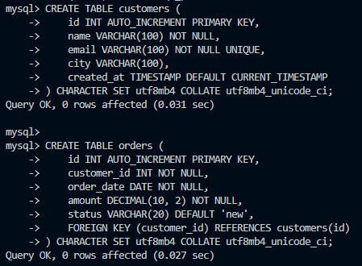

## 7.3. Обновление данных в таблице:
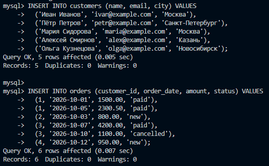
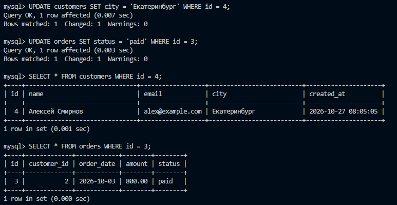

## 8.1. Создание дампа:
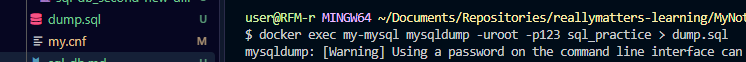

## 8.2. Содержимое:
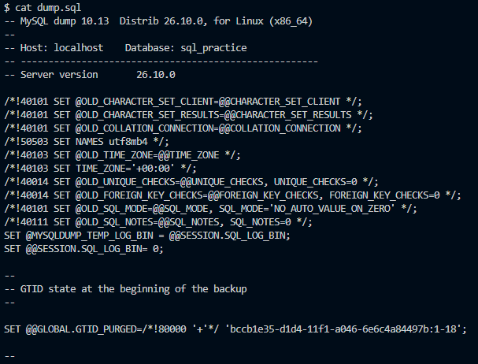