# Самостоятельная работа по Docker Databases: Нормализация данных в БД (MySQL) #2

## 1. Запуск контейнера:
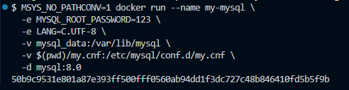

## 2. Подключение к MySQL:
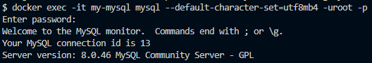

## 3. Создание БД и таблицы; вставка данных в таблицу и её показ:
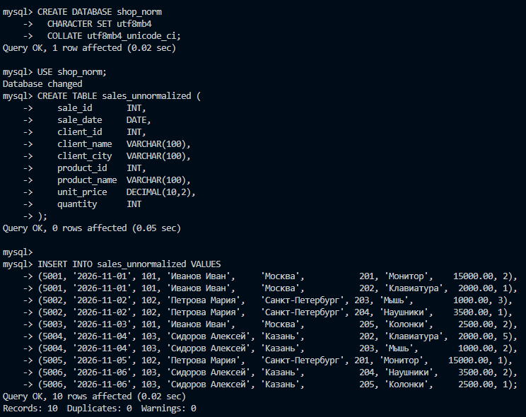
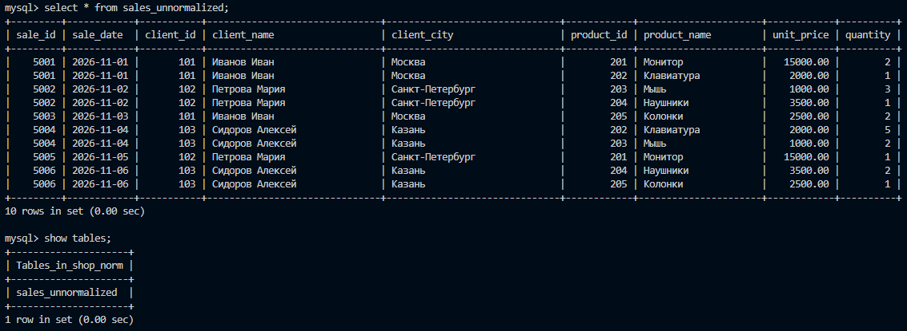

## 4. Приведение этой таблицы к третьей нормальной форме (3NF) засчёт добавления 4-ёх таблиц:
### 4.1. `clients` - клиенты:
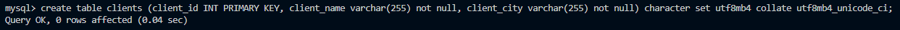
### 4.2. `products` - продукты(товары):
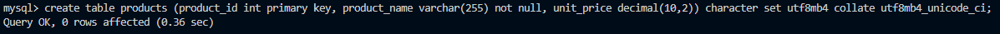
### 4.3. `sales` - продажи:
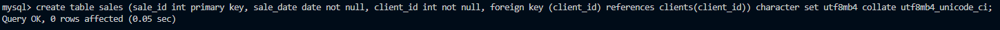
### 4.4. `sale_items` - позиции продаж:
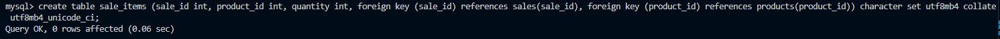

## 5. Перенесение данных с прошлой таблицы в новые:
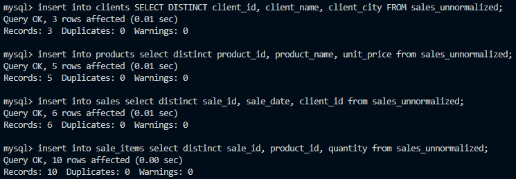
####
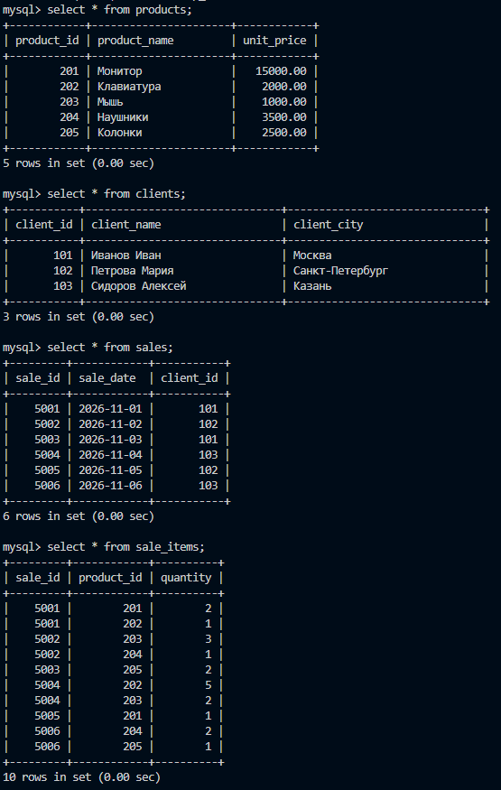

## 6. Создание дампа:
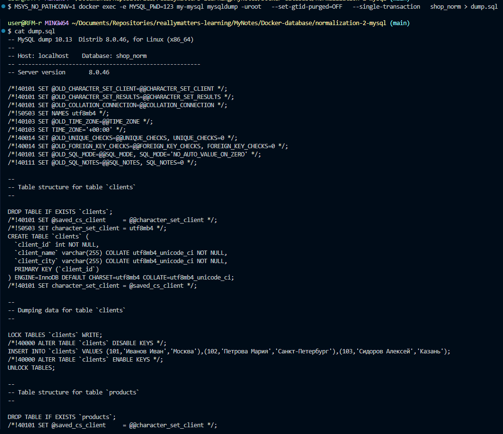

## 7. Создание лога:
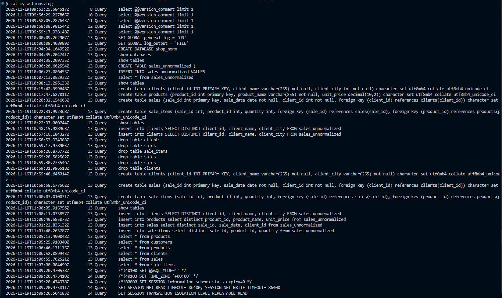
