# Самостоятельная работа по Docker Databases: Нормализация данных в БД (MySQL)

## 1. Запуск контейнера:
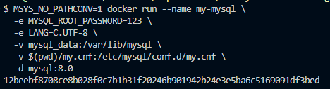

## 2. Подключение к MySQL:
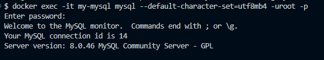

## 3. Создание БД и таблицы; вставка данных в таблицу и её показ:
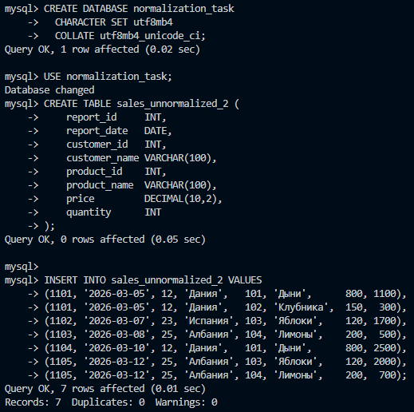
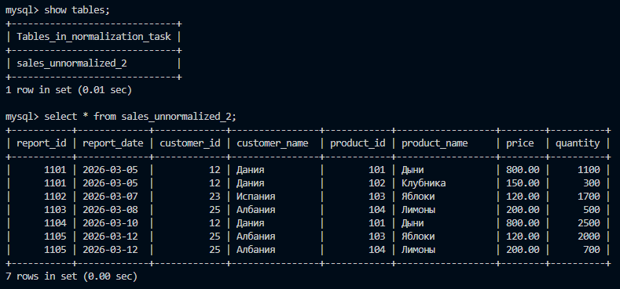
## 3.1. Аномалии:
### Вставка (insert anomaly) - остальные данные являются 'NULL', из-за того, что нельзя добавить нового покупателя без отчёта:
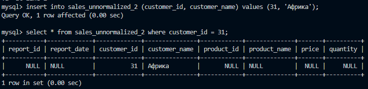
### Обновление (update anomaly) - обновление несколько строк, из-за того, что они имеют одинаковый `customer_name`:
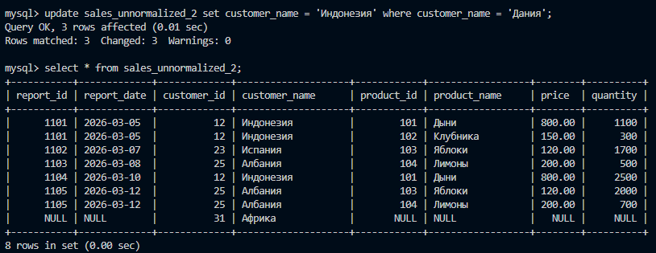
### Удаление (delete anomaly) - удаление несколько данных, из-за того, что они имеют одинаковый `customer_id`:
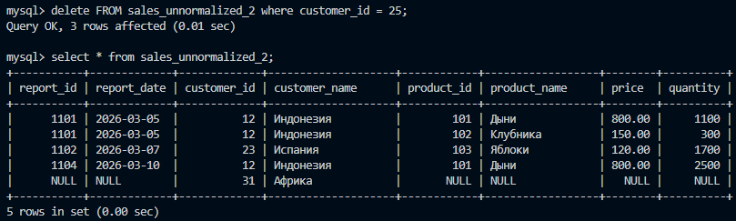

## 4. Приведение этой таблицы к третьей нормальной форме (3NF) засчёт добавления 4-ёх таблиц:
### 4.1. `customers` - покупатели:
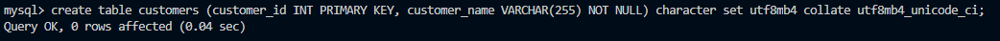
### 4.2. `products` - продукты(товары):
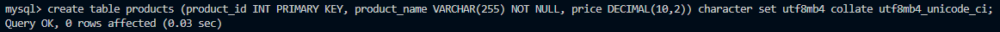
### 4.3. `reports` - отчёты(репорты):
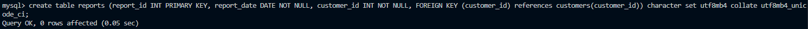
### 4.4. `report_items` - позиции отчётов:
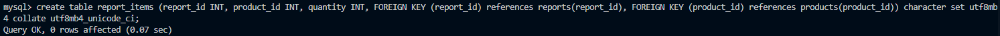

## 5. Перенесение данных с прошлой таблицы в новые:
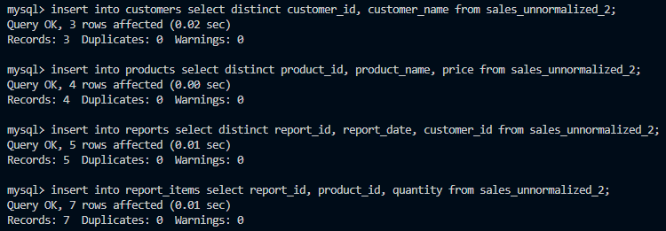
####
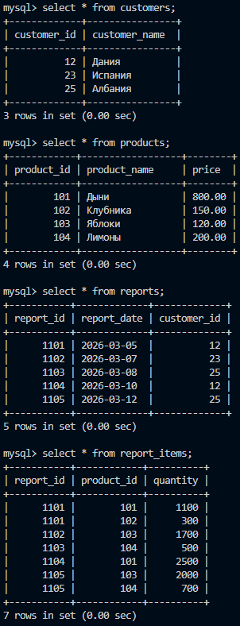

## 6. Сравнение данных с прошлой таблицы и новых:
### 6.1. `products` and `sales_unnormalized_2`:
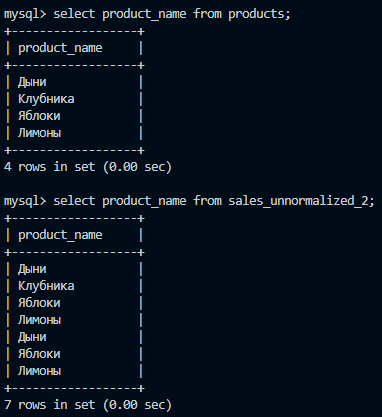
### 6.2. `reports` and `sales_unnormalized_2`:
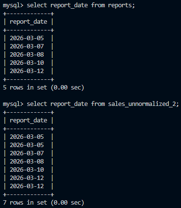
### 6.3. Общая сумма до и после:
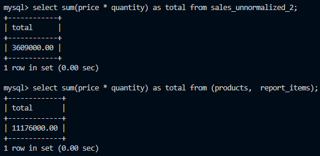

## 7. Создание дампа:
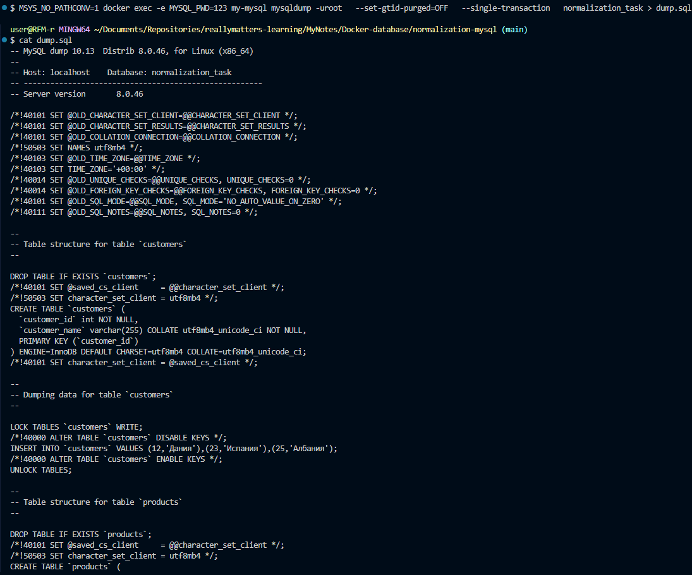

## 8. Создание лога:
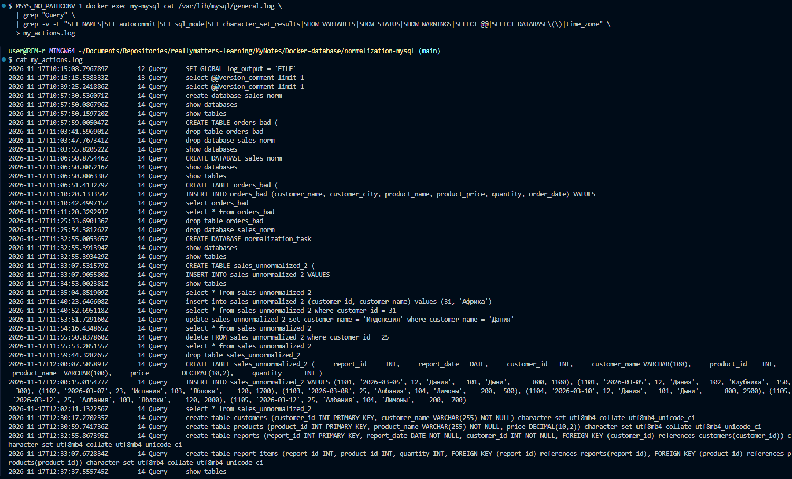