# Самостоятельная работа по Docker Databases: Основные SQL-операции на примере двух таблиц «Products 1» и «Products 2»

## 1. Запуск контейнера:
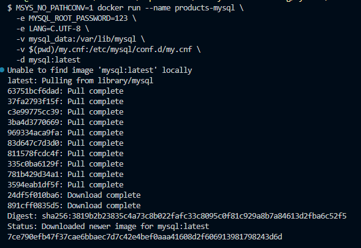

## 2. Подключение к MySQL:
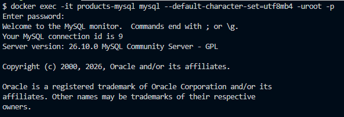

## 3. Создание базы данных:
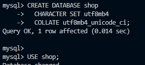

## 4. Просмотр существующих баз данных:
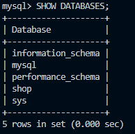

## 5. Создание таблиц:
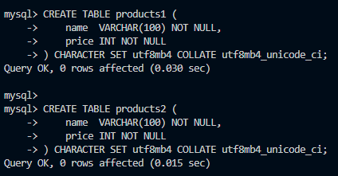

### 5.1. Их просмотр:
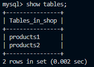

## 6. Вставка данных и их просмотр:
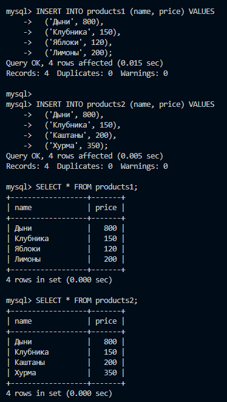

## 7. Основные операции:
### 7.1. Выборка(SELECT):
#### Вывод товаров из *products1* дороже 150:
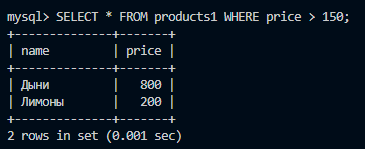

### 7.2. Проекция(PROJECTION):
#### Вывод только названий товаров из *products1*:
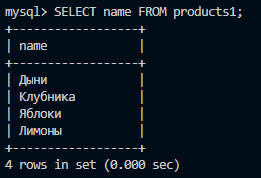

### 7.3. Объединение(UNION):
#### Получение единого списка названий товаров из обеих таблиц (без дубликатов):
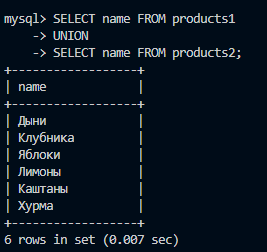

### 7.4. Разность(EXCEPT/MINUS):
#### Вывод товаров, которые есть в *products1*, но отсутствуют в *products2*:
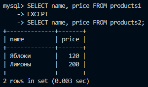

### 7.5. Пересечение(INTERSECT):
#### Нахождение товаров, которые есть и в *products1*, и в *products2* (с одинаковой ценой):
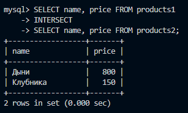

### 7.6. Декартово произведение(CARTESIAN PRODUCT):
#### Получение всех возможных пар "товар из первой таблицы — товар из второй":
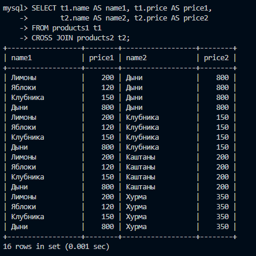

### 7.7. Соединение(JOIN):
#### Соединение таблиц по названию товара и показ цен из обеих таблиц:
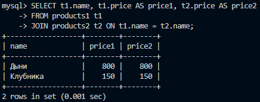

## 8. Создание дампа:
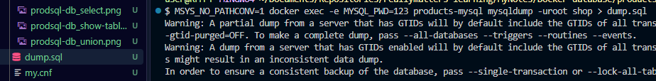
### 8.1. Просмотр созданного дампа:
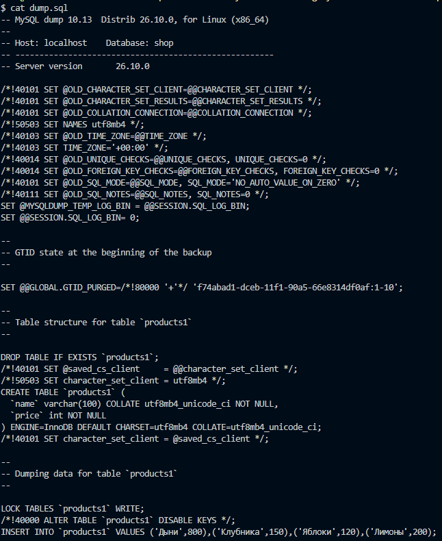

## 9. "Уборка":
### 9.1. Проверка БД и таблиц:
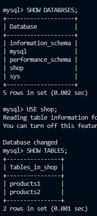

### 9.2. Удаление базы данных и проверка удаления:
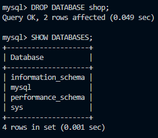

## 10. Восстановление БД из дампа:
### 10.1. Создание пустой БД с тем же именем и проверка создания:
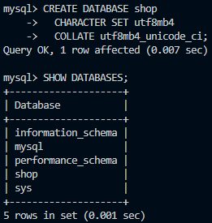

### 10.2. Импортирование:
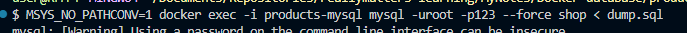

### 10.3. Проверка содержимого восстановленной БД:
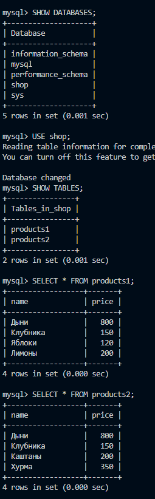