## Самостоятельная работа по Docker Databases: Представления(VIEW) в MySQL

## 1. Запуск контейнера:
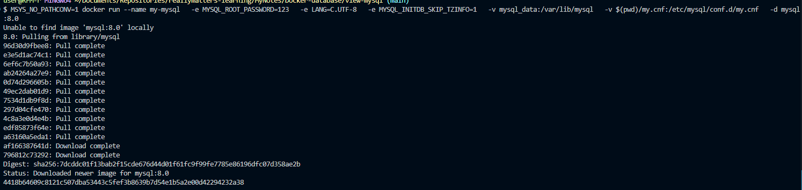

## 2. Подключение к MySQL:
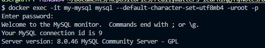

## 3. Создание базы данных и переключение на неё:
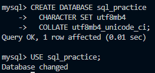

## 3.1. Создание таблиц и добавление новых данных в таблицу:
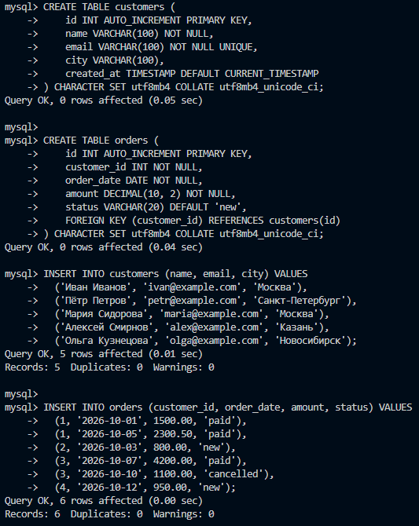

## 3.2. Проверка:
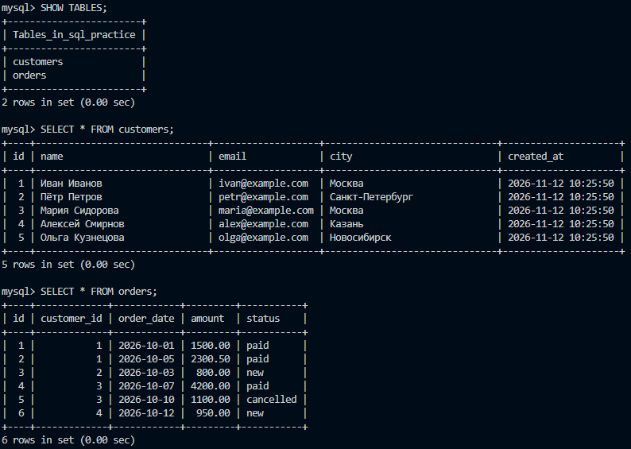

## 4. Простейшее представление:
### 4.1. Без VIEW:
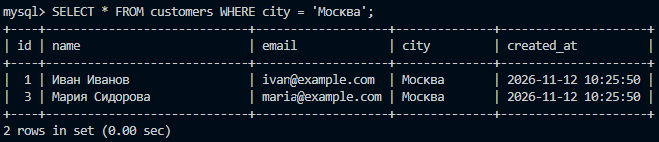

### 4.2. С VIEW:
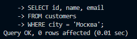
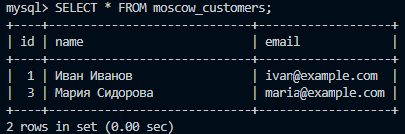

## 5. VIEW с JOIN и агрегацией:
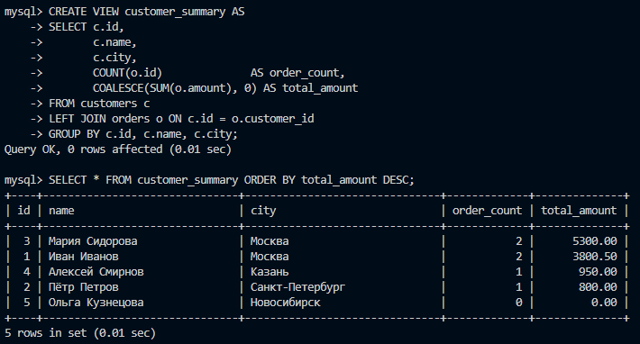

## 6. VIEW с фильтрацией внутри:
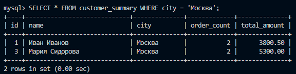

## 7. Просмотр существующих VIEW:
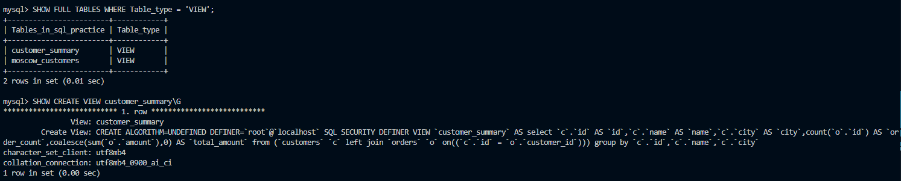

## 8. Изменение и удаление VIEW:
### 8.1. Результат изменения:
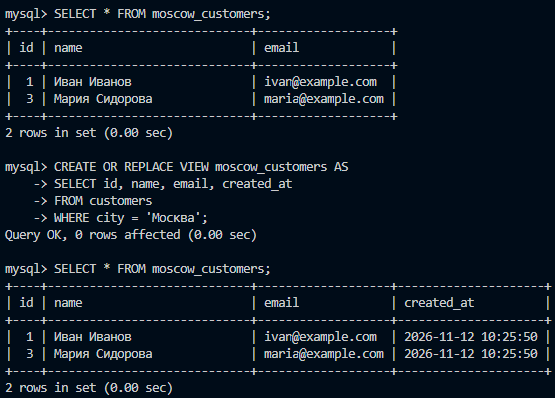

### 8.2. Результат удаления:
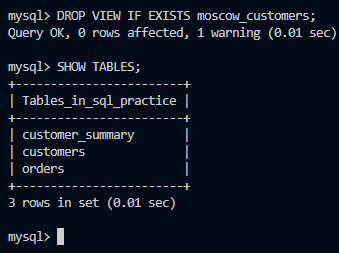

## 9. Обновляемые VIEW (UPDATE, INSERT, DELETE):
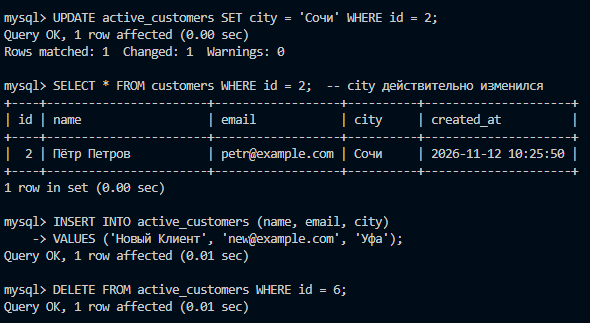

## 10. VIEW и производительность:
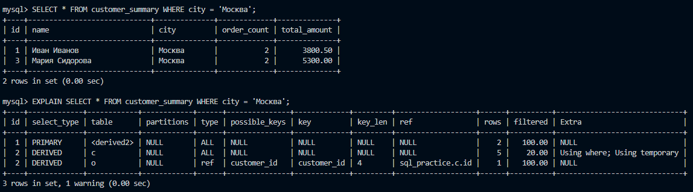

## 11. VIEW с проверкой опций (WITH CHECK OPTION):
### 11.1. Without Check Option:
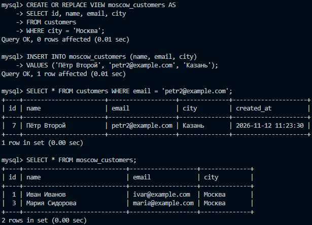

### 11.2. With Check Option:
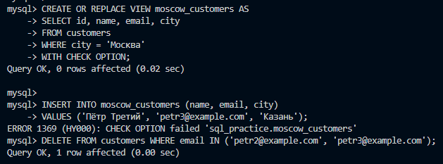

## 12. Права доступа через VIEW:
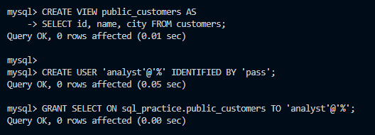

## 13. Создание дампа:
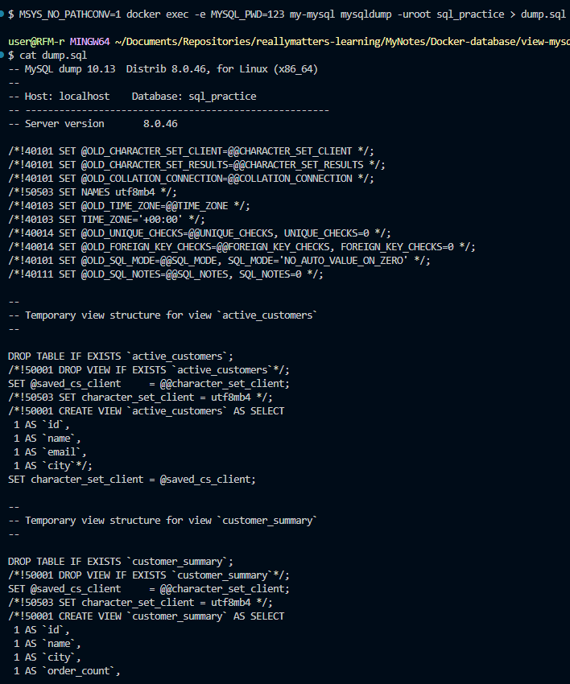

## 14. Создание лога:
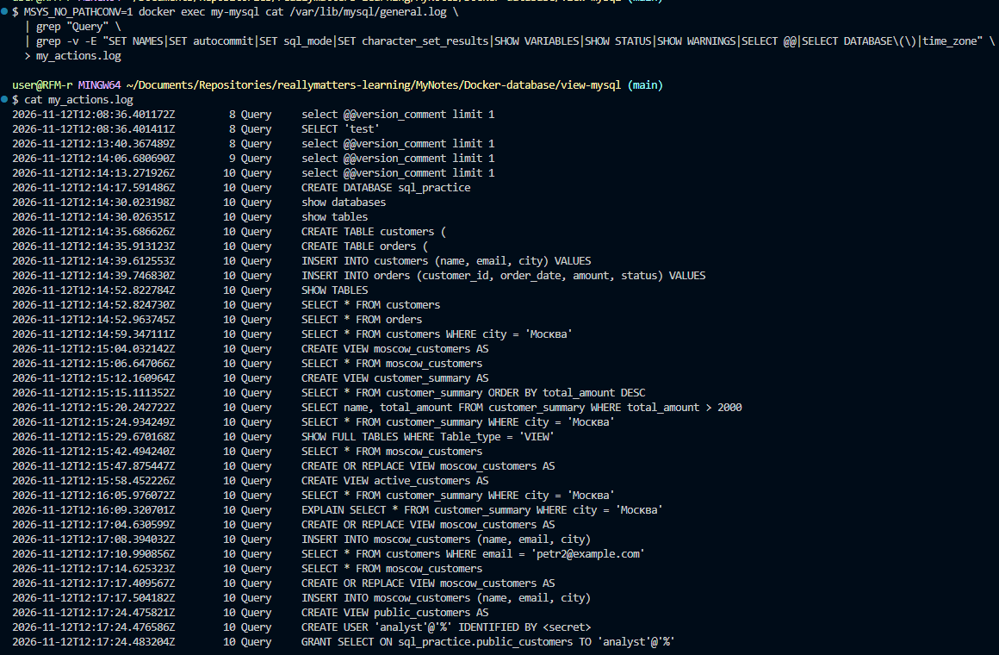